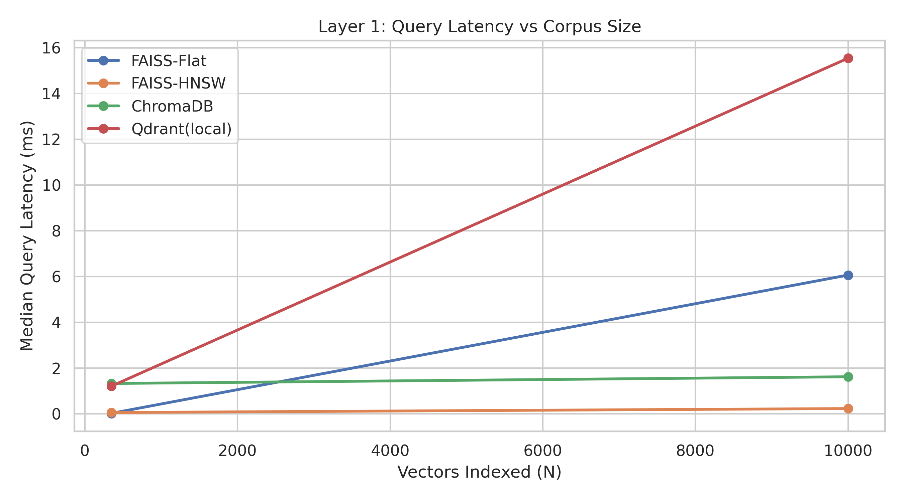
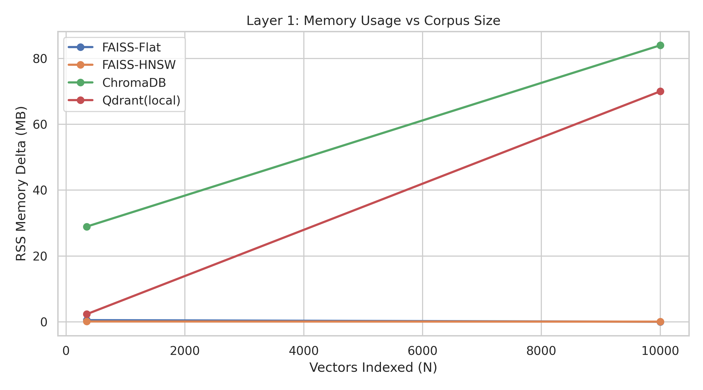
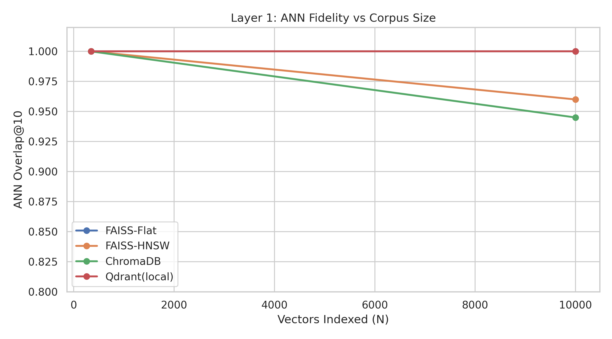
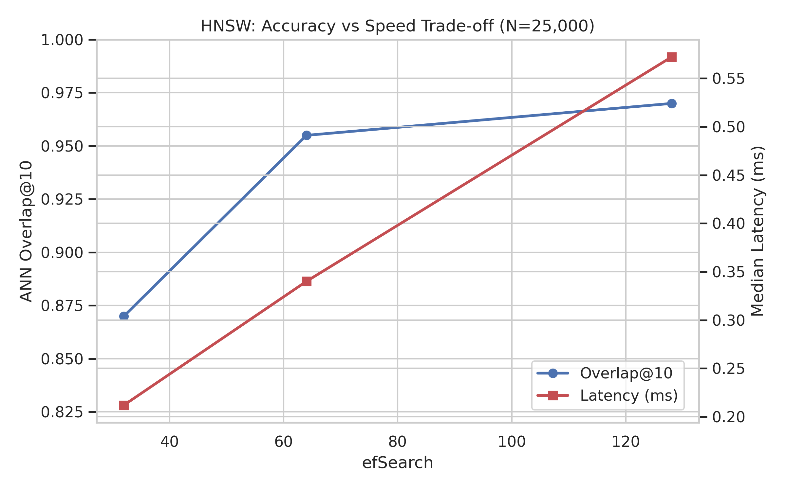
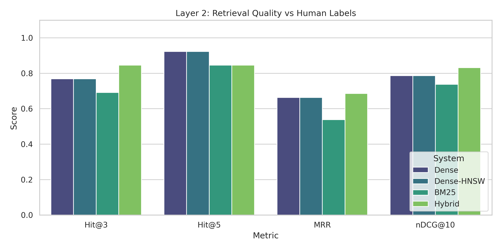
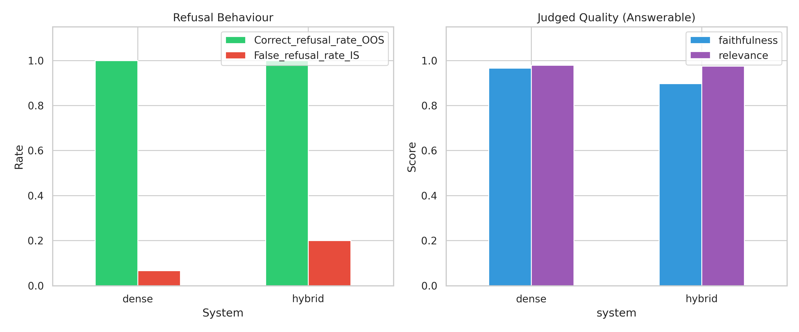

# Comparative Evaluation of Vector Databases and Hybrid Retrieval in RAG Systems

**Author:** Dev Kumar

> **Project Context** :
> This project was completed as part of a university **Term Paper** on **Retrieval-Augmented Generation (RAG) Systems**.

---

## Overview

This project presents a **controlled, reproducible benchmark** that isolates and compares vector storage backends and retrieval strategies within a Retrieval-Augmented Generation (RAG) pipeline. Using **frozen embeddings** and a fixed corpus, it eliminates confounding variables to deliver a fair, apples-to-apples comparison across three evaluation layers:

| Layer | What is Measured | Method |
|:------|:-----------------|:-------|
| **Layer 1** | Backend latency, memory, build time, ANN accuracy | Systems-level profiling (FAISS-Flat, FAISS-HNSW, ChromaDB, Qdrant) |
| **Layer 2** | Retrieval ranking quality (Hit@k, Recall@k, MRR, nDCG@10) | Human-verified relevance labels (qrels) |
| **Layer 3** | Generation faithfulness, relevance, hallucination & refusal rates | LLM-as-Judge blind A/B evaluation |

---

## Motivation

Large Language Models can generate fluent but factually incorrect text — a phenomenon known as **hallucination**. RAG mitigates this by grounding generation in retrieved evidence, but the choice of vector backend and retrieval strategy significantly impacts:

- **Faithfulness** — Does the generated answer stay true to the retrieved evidence?
- **Safety** — Does the system correctly refuse out-of-scope queries instead of hallucinating?
- **Efficiency** — Can the retrieval layer scale to production workloads?

This benchmark provides empirical evidence to guide architectural choices for building reliable, production-ready RAG systems.

---

## Architecture & Pipeline

```
┌──────────────────────────────────────────────────────────────────────────┐
│                        DATA PIPELINE (Notebook 01)                      │
│                                                                         │
│  10 ArXiv PDFs ──► PyMuPDF Extraction ──► Tiktoken Chunking (345 chunks)│
│       │                                          │                      │
│       ▼                                          ▼                      │
│  Corpus Manifest                   BAAI/bge-small-en-v1.5 Embeddings    │
│  (corpus_manifest.csv)              (doc_embeddings.npy — FROZEN)       │
│                                          │                              │
│  20 Eval Queries ──────► Query Embeddings (query_embeddings.npy)        │
└──────────────────────────┬───────────────────────────────────────────────┘
                           │
                           ▼
┌──────────────────────────────────────────────────────────────────────────┐
│                   BENCHMARK & EVALUATE (Notebook 02)                    │
│                                                                         │
│  Layer 1: Backend Benchmark          Layer 2: Retrieval Evaluation      │
│  ┌─────────────┐                     ┌──────────────┐                   │
│  │ FAISS-Flat   │   Latency,         │ Dense        │  Hit@k, Recall@k, │
│  │ FAISS-HNSW   │   Memory,          │ Dense-HNSW   │  MRR, nDCG@10     │
│  │ ChromaDB     │   Build Time,      │ BM25         │  vs Human Qrels   │
│  │ Qdrant       │   ANN Overlap      │ Hybrid (RRF) │                   │
│  └─────────────┘                     └──────────────┘                   │
└──────────────────────────┬───────────────────────────────────────────────┘
                           │
                           ▼
┌──────────────────────────────────────────────────────────────────────────┐
│              GENERATION, JUDGING & FIGURES (Notebook 03)                │
│                                                                         │
│  Layer 3: End-to-End Generation Quality                                 │
│  ┌────────────────────────────────────────────────────────────┐         │
│  │ Groq LLM Generation (Dense vs Hybrid) × 20 queries        │         │
│  │        ▼                                                   │         │
│  │ Blind A/B LLM-as-Judge (faithfulness + relevance scoring)  │         │
│  │        ▼                                                   │         │
│  │ Refusal Analysis (correct refusal, hallucination, false    │         │
│  │                    refusal rates on out-of-scope queries)   │         │
│  └────────────────────────────────────────────────────────────┘         │
│                        ▼                                                │
│              6 Publication-Quality Figures (300 DPI)                     │
└──────────────────────────────────────────────────────────────────────────┘
```

---

## Corpus

A curated collection of **10 seminal AI/ML research papers** sourced from ArXiv, covering RAG, Transformers, DPR, LoRA, FlashAttention, Self-RAG, and RAGAS:

| # | Document | Paper |
|:-:|:---------|:------|
| 1 | `doc01_rag_original` | RAG: Retrieval-Augmented Generation for Knowledge-Intensive NLP |
| 2 | `doc02_rag_survey` | RAG Survey (Gao et al., 2023) |
| 3 | `doc03_dpr` | Dense Passage Retrieval for Open-Domain QA |
| 4 | `doc04_ragas` | RAGAS: Automated Evaluation of RAG |
| 5 | `doc05_self_rag` | Self-RAG: Learning to Retrieve, Generate, and Critique |
| 6 | `doc06_transformer` | Attention Is All You Need |
| 7 | `doc07_lora` | LoRA: Low-Rank Adaptation of Large Language Models |
| 8 | `doc08_flash_attention` | FlashAttention: Fast and Memory-Efficient Attention |
| 9 | `doc09_rag_survey_huang` | RAG Survey (Huang et al., 2024) |
| 10 | `doc10_comprehensive_rag` | Comprehensive RAG Survey (2024) |

The corpus is processed into **345 text chunks** using `tiktoken` (cl100k_base tokenizer) with bibliography sections filtered out. All chunks are embedded once with [`BAAI/bge-small-en-v1.5`](https://huggingface.co/BAAI/bge-small-en-v1.5) and **frozen** — the same embeddings are reused across all experiments to eliminate embedding variability.

**Evaluation queries** consist of 20 curated questions: 8 conceptual, 7 keyword/metric-extraction, and 5 out-of-scope (unanswerable) queries used to test refusal behavior.

---

## Methodology

### Layer 1 — Vector Backend Systems Benchmark

Four vector storage backends are benchmarked at two scales (N=345 real chunks, N=10,000 synthetic vectors):

- **FAISS-Flat** — Exact brute-force inner-product search
- **FAISS-HNSW** — Approximate Nearest Neighbor with Hierarchical Navigable Small Worlds
- **ChromaDB** — Lightweight embedding database
- **Qdrant (local mode)** — Feature-rich vector database

**Measured metrics:** Index build time, vectors/sec throughput, RSS memory delta, median & P95 query latency, ANN overlap@10 vs exact search.

An additional **HNSW efSearch sweep** at N=25,000 tests the recall–latency trade-off across ef ∈ {32, 64, 128}.

### Layer 2 — Information Retrieval Quality (Human-Verified Qrels)

Four retrieval strategies are evaluated against **human-verified relevance judgements** (qrels, graded 0/1/2):

- **Dense** — FAISS-Flat cosine similarity search
- **Dense-HNSW** — FAISS-HNSW approximate search
- **BM25** — Sparse lexical retrieval (Okapi BM25)
- **Hybrid (RRF)** — Reciprocal Rank Fusion of Dense + BM25

Relevance labels were bootstrapped via LLM-assisted pre-labelling (Groq) and then **manually verified** by the author. Metrics: Hit@k, Recall@k (k = 1, 3, 5, 10), MRR, nDCG@10.

### Layer 3 — End-to-End Generation Quality & Safety

Using the top-performing retrieval systems (Dense and Hybrid), answers are generated via **Groq LLM inference** and evaluated by a **blind A/B LLM-as-Judge** from a different model family to avoid self-bias:

- **Faithfulness** — Does the answer stay grounded in the retrieved context?
- **Relevance** — Does the answer address the user's question?
- **Refusal analysis** — Correct refusal rate, hallucination rate, and false refusal rate on out-of-scope queries.

---

## Key Results

### Backend Performance at Scale

| Backend | N | Build (s) | Vectors/s | RSS Δ (MB) | Median (ms) | P95 (ms) | ANN Overlap@10 |
|:--------|----:|----------:|----------:|-----------:|------------:|---------:|---------------:|
| FAISS-Flat | 345 | 0.0005 | 679,778 | 0.50 | 0.022 | 0.033 | 1.000 |
| FAISS-HNSW | 345 | 0.0322 | 10,707 | 0.09 | 0.058 | 0.090 | 1.000 |
| ChromaDB | 345 | 0.1836 | 1,880 | 28.92 | 1.327 | 1.787 | 1.000 |
| Qdrant | 345 | 0.0760 | 4,537 | 2.30 | 1.207 | 1.449 | 1.000 |
| FAISS-Flat | 10,000 | 0.0053 | 1,887,280 | 0.00 | 6.064 | 9.986 | 1.000 |
| FAISS-HNSW | 10,000 | 4.3798 | 2,283 | 0.04 | 0.231 | 0.301 | 0.960 |
| ChromaDB | 10,000 | 3.9464 | 2,534 | 84.05 | 1.621 | 1.859 | 0.945 |
| Qdrant | 10,000 | 1.0730 | 9,319 | 70.05 | 15.539 | 32.844 | 1.000 |

> **Key takeaway:** FAISS-HNSW delivers **0.231 ms median latency** at N=10,000 — a 26× speedup over FAISS-Flat — while maintaining 96% ANN overlap with exact search.

### HNSW efSearch Sweep

| efSearch | N | Median (ms) | P95 (ms) | ANN Overlap@10 |
|:---------|------:|------------:|---------:|---------------:|
| 32 | 25,000 | 0.212 | 0.292 | 0.870 |
| 64 | 25,000 | 0.340 | 0.466 | 0.955 |
| 128 | 25,000 | 0.572 | 0.808 | 0.970 |

### Retrieval Quality

| Strategy | Hit@1 | Recall@1 | Hit@3 | Recall@3 | Hit@5 | Recall@5 | Hit@10 | Recall@10 | MRR | nDCG@10 |
|:---------|------:|---------:|------:|---------:|------:|---------:|-------:|----------:|----:|--------:|
| Dense | 0.538 | 0.333 | 0.769 | 0.494 | 0.923 | 0.763 | 0.923 | 0.865 | 0.663 | 0.787 |
| Dense-HNSW | 0.538 | 0.333 | 0.769 | 0.494 | 0.923 | 0.763 | 0.923 | 0.865 | 0.663 | 0.787 |
| BM25 | 0.308 | 0.179 | 0.692 | 0.474 | 0.846 | 0.744 | 0.923 | 0.788 | 0.538 | 0.738 |
| **Hybrid (RRF)** | **0.538** | 0.282 | **0.846** | **0.590** | 0.846 | 0.712 | **1.000** | **0.974** | **0.686** | **0.832** |

> **Key takeaway:** Hybrid RRF achieves the **highest nDCG@10 (0.832)** and **perfect Hit@10 (1.000)**, outperforming both pure Dense and pure BM25 strategies by combining their complementary strengths.

### Generation Quality & Refusal Safety

| System | Faithfulness | Relevance | n |
|:-------|------------:|----------:|--:|
| Dense | 0.966 | 0.979 | 14 |
| Hybrid | 0.898 | 0.975 | 12 |

| System | Correct Refusal (OOS) | Hallucination (OOS) | False Refusal (IS) |
|:-------|----------------------:|--------------------:|-------------------:|
| Dense | 100% | 0% | 6.7% |
| Hybrid | 100% | 0% | 20.0% |

> **Key takeaway:** Both systems achieve **0% hallucination** on out-of-scope queries and **100% correct refusal**. Dense retrieval yields higher faithfulness (0.966 vs 0.898) and a lower false refusal rate (6.7% vs 20.0%).

### Architectural Decision Matrix

| Criterion | Winner | Evidence |
|:-----------|:-----------|:------------------------------------------|
| Lowest query latency (N=10,000) | **FAISS-HNSW** | 0.231 ms median (ANN overlap@10 = 0.960) |
| Lowest memory growth (N=10,000) | **FAISS-Flat** | 0.00 MB RSS delta |
| Best retrieval ranking quality | **Hybrid RRF** | nDCG@10 = 0.832, MRR = 0.686, Recall@10 = 0.974 |
| Highest generation faithfulness | **Dense** | Faithfulness = 0.966, False refusal = 6.7% |

---

## Figures

All figures are generated at **300 DPI** in Notebook 03 and saved to `results/`.

### Fig 1 — Backend Latency vs Scale
<p align="center">
  
</p>

> Median query latency across four vector backends at N=345 and N=10,000. FAISS-HNSW maintains sub-millisecond latency even at scale, while FAISS-Flat latency grows linearly.

### Fig 2 — Memory Footprint vs Scale
<p align="center">
  
</p>

> RSS memory delta comparison. ChromaDB and Qdrant incur significant memory overhead at N=10,000 (84 MB and 70 MB respectively), while FAISS variants remain near-zero.

### Fig 3 — ANN Overlap with Exact Search
<p align="center">
  
</p>

> Approximate Nearest Neighbor overlap@10 relative to exact (FAISS-Flat) results. All backends achieve perfect overlap at N=345; at N=10,000, FAISS-HNSW and ChromaDB show slight degradation (0.960 and 0.945).

### Fig 4 — HNSW efSearch Sweep (N=25,000)
<p align="center">
  
</p>

> Trade-off between query latency and recall accuracy as efSearch increases from 32 to 128. ef=64 offers a balanced sweet spot (0.340 ms, 95.5% overlap).

### Fig 5 — Retrieval Quality (Human-Verified Qrels)
<p align="center">
  
</p>

> nDCG@10, MRR, and Recall@10 for all four retrieval strategies evaluated against human-verified relevance labels. Hybrid RRF dominates across all ranking metrics.

### Fig 6 — Generation Quality (LLM-as-Judge)
<p align="center">
  
</p>

> Faithfulness and relevance scores from blind A/B LLM-as-Judge evaluation. Dense retrieval achieves higher faithfulness (0.966) while both systems maintain high relevance (>0.97).

---

## Repository Structure

```
rag/
├── README.md                          # This file
├── requirements.txt                   # Python dependencies
├── .gitignore                         # Git ignore rules
│
├── notebooks/                         # End-to-end Colab notebooks
│   ├── 01_data_pipeline.ipynb         # PDF ingestion, chunking, embedding
│   ├── 02_benchmark_and_evaluate.ipynb# Backend benchmark + retrieval eval
│   └── 03_generation_judge_figures.ipynb # Generation, judging, figures
│
├── src/                               # Modular Python source
│   ├── retrieval.py                   # HybridRetriever: Dense, HNSW, BM25, RRF
│   └── metrics.py                     # IR evaluation (Hit@k, Recall@k, MRR, nDCG)
│
├── scripts/
│   └── download_corpus.py             # Automated download of 10 ArXiv PDFs
│
├── data/
│   ├── raw_pdfs/                      # 10 source PDFs (downloaded via script)
│   ├── processed/                     # Processed data artifacts
│   │   ├── corpus_manifest.csv        # Document metadata & URLs
│   │   ├── chunks.json                # 345 text chunks
│   │   ├── eval_queries.json          # 20 evaluation queries
│   │   ├── qrels_labeled.csv          # Human-verified relevance labels
│   │   ├── qrels_prelabeled.csv       # LLM-assisted pre-labels
│   │   ├── qrels_to_label.csv         # Raw labelling pool
│   │   └── numpy_exact_topk.json      # Brute-force exact top-k baseline
│   └── embeddings/                    # Frozen embeddings
│       ├── doc_embeddings.npy         # Document chunk embeddings (345×384)
│       ├── query_embeddings.npy       # Query embeddings (20×384)
│       └── chunk_ids.json             # Chunk ID mapping
│
└── results/                           # Benchmark outputs & figures
    ├── layer1_scaling_raw.csv         # Backend benchmark data (N=345, N=10k)
    ├── layer1_hnsw_ef_sweep.csv       # HNSW efSearch sweep data (N=25k)
    ├── layer2_retrieval_vs_human_qrels.csv # Retrieval metrics vs human labels
    ├── layer3_quality.csv             # Generation quality (grouped)
    ├── layer3_quality_flat.csv        # Generation quality (flat)
    ├── layer3_refusal_metrics.csv     # Refusal & hallucination rates
    ├── decision_matrix.csv            # Final architectural recommendations
    ├── generations.jsonl              # Raw LLM-generated answers (40 entries)
    ├── judgements.jsonl                # LLM-as-Judge blind A/B scores (14 entries)
    ├── fig1_latency_vs_scale.png      # Backend latency comparison
    ├── fig2_memory_vs_scale.png       # Memory footprint comparison
    ├── fig3_ann_overlap.png           # ANN overlap accuracy
    ├── fig4_hnsw_ef_sweep.png         # HNSW ef trade-off curve
    ├── fig5_retrieval_quality.png     # Retrieval quality bar chart
    └── fig6_generation_quality.png    # Generation quality bar chart
```

---

## Getting Started

### Prerequisites

- **Python 3.10+**
- **GPU recommended** (T4 or better for embedding generation; CPU works but is slower)
- **API keys** for [Groq](https://console.groq.com/) (used for LLM generation and judging)

### Installation

```bash
# Clone the repository
git clone https://github.com/<your-username>/rag.git
cd rag

# Install dependencies
pip install -r requirements.txt
```

### Reproducing the Experiments

The project is designed to run sequentially via three Colab notebooks:

```
1️⃣  notebooks/01_data_pipeline.ipynb
    → Downloads PDFs, chunks text, generates & freezes embeddings

2️⃣  notebooks/02_benchmark_and_evaluate.ipynb
    → Runs Layer 1 backend benchmark + Layer 2 retrieval evaluation

3️⃣  notebooks/03_generation_judge_figures.ipynb
    → Runs Layer 3 generation + judging, generates all 6 figures
```

Alternatively, download the corpus locally:

```bash
python scripts/download_corpus.py
```

> **Note:** All intermediate data artifacts (chunks, embeddings, qrels, results) are included in this repository, so you can skip to any notebook without re-running earlier stages.

---

## Tech Stack

| Component | Technology |
|:----------|:-----------|
| Embedding Model | [BAAI/bge-small-en-v1.5](https://huggingface.co/BAAI/bge-small-en-v1.5) (384-dim) |
| Vector Backends | FAISS (Flat + HNSW), ChromaDB, Qdrant |
| Sparse Retrieval | BM25 (rank-bm25) |
| Fusion | Reciprocal Rank Fusion (RRF, k=60) |
| LLM Inference | Groq Cloud (Llama, GPT-oss models) |
| LLM Judging | Blind A/B via separate model family |
| Tokenizer | tiktoken (cl100k_base) |
| PDF Extraction | PyMuPDF |
| Profiling | psutil (RSS memory tracking) |
| Visualization | Matplotlib + Seaborn (300 DPI) |
| Notebooks | Google Colab (T4 GPU) |

---

## License

This project is for academic and educational purposes.
